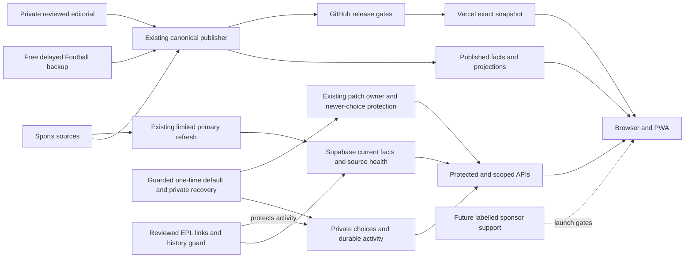

# Nothing Sport — current architecture and next step

**13 October 2026 · Verified live app 7a614317 / version 524**

Keep the present stack. The important work is making its boundaries clearer and proving the remaining launch checks. A rewrite is not supported by the current evidence.

The website uses published sports facts and limited current-data checks. GitHub runs the existing card publisher and release checks; Vercel serves the checked app. Supabase keeps current facts, account choices, ratings, predictions and points. Private editorial is reviewed before publication. Future sponsorship remains separate and inactive.

Earlier base-map SVG: `/Users/jackhartican/Documents/AI/Codex/nothingsport-architecture-current-2026-10-13/architecture.svg`.

## What is now verified

- The live release, both public aliases, protected project alias and affected served files agree with the published snapshot. Ordinary publishing and the separate ordinary EPL data update have passed their dated checks.
- The free delayed Football backup belongs to the existing publishing workflow. Its secret is passed there; no browser credential or extra live polling is added.
- All 380 EPL fixtures have the exact reviewed links in their stored payloads and lookup keys. The history bridge protects the two reviewed older activity namespaces and preserves original customer records during cutover. Later routine reminder bookkeeping is separate; it did not dispatch a reminder during the follow-up window.
- The browser keeps results hidden and reminders off when chosen. Desktop browser and installed-browser rehearsals are evidence for those environments; physical-phone proof remains open.

## The delivered architecture change

The approved card update is live on shell 523, using the existing shared code owner and unchanged startup/cache limits. It reuses one rendering path while retaining sport-specific score rules, source dates, saved choices and delayed/stale labels. Keep facts, personalisation, editorial and future commercial placements separately owned. This replaces duplicate work; it does not introduce another service or routine for the owner.

The checked Horse follow module is also live on shell 524. One shared domestic classifier prevents redundant filters; the existing account patch owner protects newer choices against stale devices. A one-time private cohort and completion marker provide recovery and prevent repeated defaults. All eleven registered accounts are verified, with other saved state and notification choices unchanged. Private snapshots deny customer access and cascade on account deletion. This adds no provider, endpoint, timer or recurring owner work. [Dated delivery](horse-flagship-current-2026-10-13.md).

## What still blocks launch approval

The report's 0/18 families and 0/3 Football pilots mean no full six-gate certificate is complete. The contract currently contains zero certificates; the auditor checks reference syntax and existence, not real-world truth. Its output is not a judgement that every sport or shipped feature is broken.

A complete approval needs evidence for fixture accuracy, timing/results, Australian viewing, source-backed context, presentation/behaviour, and reliable operation/commercial permission. Unpublished future results and teams must stay unknown; the MVP requirement does not authorise invented future sporting inputs. Physical-phone use, paid playback, provider/asset permissions, independent recovery and genuine invited-user return visits remain open.

The recovery rehearsal and cloud reconstruction have useful bounded proof. Retrieval of the existing iCloud bundle and separate saved Passwords key from another device remains unverified. The rejected automation route stays parked; no credential export or rekey is used to fill the gap.

## One operating path

Use the authoritative delivery queue and this compact map before reading large files. Use the Follow and backend decisions before changing their behaviour. Reuse unchanged evidence, test the changed risk boundaries and publish through the same checked release owner. Keep owner questions to material choices, spending and actions requiring direct authorisation. No new service, purchase, scheduler or recurring owner task is introduced. The separately checked live card and Horse changes retain their own release evidence.

The original 51 audit chapters and three original diagrams are preserved. This is a dated current supplement. Existing model/runner costs are unpriced.

## Source map for implementation

Evidence inspected: `.github/workflows/canonical-card-refresh.yml`, `.github/workflows/sportscal-production.yml`, `api/feed.js`, `api/user-state.js`, `lib/live-fixtures.js`, `lib/compact-fixture-observations.js`, `lib/supabase-server.js`, `lib/editorial-maintenance.js`, `scripts/audit-coverage-quality.js` and `config/quality/coverage-contract.json`. Release: workflow 38322796704, READY dpl_3WnfLDuJvg8iSCnE6tCzEePJ66uM. Ordinary primary: revision 9334, checked 13 October 00:04:10.399495 UTC, zero failures. Detailed receipts: `/Users/jackhartican/Documents/AI/Codex/football-fixture-continuity-2026-10-13/natural-owner-verified.json`; current viewing: `/Users/jackhartican/Documents/AI/Codex/football-viewing-current-2026-10-13/comparison.json`.

Latest release: [38365280599](https://github.com/hartican/sportscal/actions/runs/38365280599), exact app 7a614317, READY dpl_D7wbtpUgpPZVHPwU3M2fa68Gdh2c. Separate guarded account application: 13 October 08:08:56 UTC, eleven verified accounts. No provider refresh is attributed to this app release.
